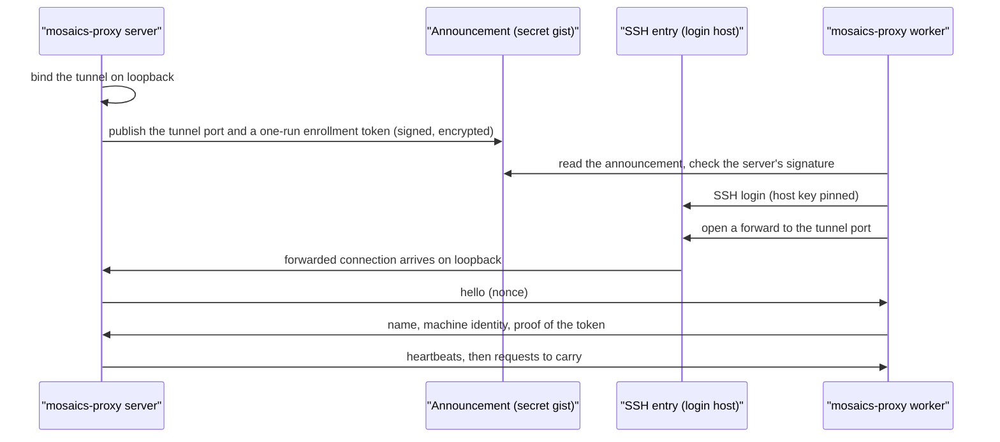

# `mosaics-proxy` — Distributed Multi-Node Request Pool

`mosaics-proxy` (`uv run -m mosaics.cli.proxy`) coordinates outbound archive HTTP requests across several worker machines, so that a download is spread over more than one IP address and each machine stays inside the per-origin concurrency cap. The concepts are in [Archive rate limits and multi-node execution](../concepts/archives.md); a collaborator who only wants to lend a machine reads [Run a worker](../getting-started/run-a-worker.md).

## Subcommands

- `server`: Run the proxy on the main node. It accepts HTTP proxy requests from the pipelines on `--proxy-port`, schedules each onto a worker, heartbeats the workers over the `heartbeat@mosaics` SSH subsystem and, with `--stats-port`, serves live per-worker telemetry. With `--announce` it also tells workers where to find it.
- `worker`: Run on a machine that lends its IP address. It dials out to the server, so it needs no open port and no inbound firewall rule.
- `announce`: Create, show or stop the announcement, the small encrypted record that tells workers where the server is.
- `workers`: Print what each worker name has contributed, from the server’s ledger.
- `keygen`: Generate the SSH key material of the manual setup (below).

## How a worker finds the server

A worker started without `--server` finds the server by itself. Nothing about the server’s address is typed on the worker’s side.



1. **Server `--announce`.** The server binds the worker tunnel on loopback only, because workers arrive through an SSH login on the main node’s network rather than straight to the tunnel port. It then publishes the port it actually bound (`--tunnel-port 0` takes a free port) and a fresh enrollment token to the announcement. The announcement is encrypted and signed with the server’s key, so a worker only trusts one the server made. It is marked *stopped* when the server exits cleanly, and `announce --stop` does the same after a server that was killed. `--machine` names which SSH entry the announcement points workers to; it defaults to the only entry.
2. **The SSH entry.** An *SSH entry* is a named login host that the worker knows: host, port, user and the pinned host key. The worker logs in with the credential built into its release, checks the host key against the pinned one, and asks the host to forward a connection to the server’s tunnel port. A host that presents any other key is refused, so a man in the middle cannot collect the credential. If the host refuses the forward by policy, the worker stops with a message instead of retrying.
3. **Enrollment.** Right after the SSH handshake the server sends a `hello` with a random nonce. The worker answers with its name, its [machine identity]() and a proof that it holds this run’s enrollment token. A wrong proof, a missing answer or an incompatible protocol closes the connection, and the reason is logged on the server. `--enroll token` (the default with `--announce`) accepts any worker key that proves the token; `--enroll known-hosts` accepts only the keys listed by `keygen`, which is the older setup.
4. **Reconnects.** A dropped tunnel is retried against the same endpoint with back-off (1 s doubling up to 60 s). After three failures in a row, or a *stopped* announcement, the worker reads the announcement again, at most once every 2 minutes. A rejected SSH password is retried once after re-reading the announcement, then at 15-minute intervals, and the worker exits after four such failures: a loop of wrong passwords would get the worker’s address banned. Reads of the announcement go through a CDN first, so after a server restart a worker can keep the old port for up to about 5 minutes. `--min-worker VERSION` tells workers older than `VERSION` to stop and ask the user to run the command again.

## Worker names and identity

Every worker has a name of 1 to 64 letters, digits or hyphens (`--name`, required unless `--server` is given, which defaults it to the short host name). The server shows the name in `/stats`, in the ledger, in Weights & Biases and in the targets report’s node table, and the worker’s host key is made under it (`<name>_worker_host_key` in `--key-dir`), so two names on one machine stay distinct and a worker that restarts keeps its identity.

Besides the name, the hello carries a [machine identity](): host name, user, operating system, CPU, memory, addresses and a hash of the machine id. The server uses it to tell machines apart and to credit each with what it carried. When two connected workers report the same public IP it warns, because the archives see them as one address and the second adds no rate-limit headroom.

## What the server learns about a worker

The identity has these fields. Each is best effort and is `null` when it cannot be read.

| Field                                                                               | Content                                                                                                                                                               |
|-------------------------------------------------------------------------------------|-----------------------------------------------------------------------------------------------------------------------------------------------------------------------|
| `name`, `hostname`, `fqdn`, `user`                                                  | The worker name, the short and the fully qualified host name, the login name of the user running the worker.                                                          |
| `os`, `kernel`, `distro`, `arch`                                                    | Operating system, kernel release, distribution (`PRETTY_NAME`), CPU architecture.                                                                                     |
| `cpu_count`, `cpu_model`, `mem_total_gb`                                            | Logical CPUs, CPU model string, installed memory in GB.                                                                                                               |
| `python`, `worker_version`, `build_id`, `protocol`, `pid`, `started_at`, `timezone` | The interpreter and worker release, the build, the protocol version, the process id, the start time (UTC) and the local time zone.                                    |
| `local_ips`                                                                         | The addresses of the network interfaces, plus the address of the default route.                                                                                       |
| `public_ip`                                                                         | The address the archives see, from one request to a public-address service (`api.ipify.org`, else `1.1.1.1/cdn-cgi/trace`), made once per process with a 5 s timeout. |
| `machine_id`                                                                        | The first 16 hexadecimal characters of the SHA-256 of the machine id, never the id itself.                                                                            |
| `container`, `wsl`                                                                  | Whether the worker runs in a container or in WSL.                                                                                                                     |

## The ledger, the stats endpoint and Weights & Biases

- **Ledger.** The server appends to `~/.mosaics/proxy/workers.jsonl` (`--ledger` changes it): one `register` record and one `unregister` record per session, with the identity and the session totals (leases, bytes in each direction, refused, dead and dropped requests, seconds connected, bytes and leases per origin). The file is created readable by its owner only. It holds the collaborators’ host names, user names and addresses, so it is personal data: keep it out of the repository and out of reports. A session is written when it ends, so one still open does not appear yet.
- **`mosaics-proxy workers [--ledger PATH] [--since DATE]`** reads the ledger back into a contribution table: per name, sessions, hours connected, leases, GB downloaded, the top origins, the hosts and addresses seen, and the last time seen.
- **`/stats`** (only with `--stats-port`; off by default, bound to `--proxy-host`) lists each worker under a short id with its `name`, `host` and `public_ip`, its totals and its measured health per origin. `/events` shows registrations with the name.
- **Weights & Biases** (`--wandb`; `--wandb-project`, default `mosaics-proxy`; `--wandb-entity`, default the account’s own; `--wandb-interval`, default 60 s). One run per server process: a `workers/registry` table (one row per registration, with the identity), a `workers/sessions` table (one row per finished session), a `workers/contribution` snapshot of bytes and leases by name and origin, and per-name metrics every interval. The project holds the same personal data as the ledger, so keep it private.
- **Targets report.** A run that used the pool lists each node as `<name> (<short id>)`.

## Secrets

No secret is ever a flag, so none appears in `ps` or in the shell history. The server reads the announcement’s id and key, the token that writes the announcement (else the login of `gh` on the machine) and the credentials of its SSH entries from its settings file in the private repository. An environment variable of the same purpose overrides a value there: `MOSAICS_PROXY_GIST_ID`, `MOSAICS_WORKER_SECRET`, `MOSAICS_PROXY_GIST_TOKEN` and, per SSH entry, `MOSAICS_PROXY_SSH_PASSWORD_<NAME>` or `MOSAICS_PROXY_SSH_KEY_FILE_<NAME>`. A worker release carries the credentials it needs inside its encrypted payload, so changing the SSH password or host means building a new release.

## Setup without the announcement

`keygen` makes the key material for a worker you set up by hand on a machine you control. Run it on the main node once per worker, each time with a distinct `--worker-name`: it writes the server key, the worker’s host key, `authorized_keys` (the server’s public key, which the worker accepts) and `known_hosts` (the worker keys the server accepts) into `--key-dir`. Copy the worker’s host key and `authorized_keys` to the same directory on the worker, and start it with `--server HOST:PORT`. The server runs with `--enroll known-hosts`, the default without `--announce`.

```console
$ uv run -m mosaics.cli.proxy keygen --worker-name lab-gpu
$ uv run -m mosaics.cli.proxy server --proxy-port 8888 --tunnel-port 8022 --stats-port 8889
$ uv run -m mosaics.cli.proxy worker --name lab-gpu --server 10.0.0.1:8022
```

The announced setup is one command on each side:

```console
$ uv run -m mosaics.cli.proxy server --announce --wandb
$ curl -sL <the address you were given> | sh -s -- NAME
```

Point a pipeline at the server with `--proxy http://127.0.0.1:8888`.

## Command-line reference

<!-- generated:cli-proxy -->

**Entry points:** `mosaics-proxy` or `uv run -m mosaics.cli.proxy`

### Top-level options

```text
mosaics.cli.proxy [-h] {keygen,server,announce,workers,worker} ...
```

### `mosaics-proxy keygen`

Generate the SSH key material both sides of the tunnel need.

```text
mosaics.cli.proxy keygen [-h] [--worker-name WORKER_NAME] [--overwrite]
                                [--config CONFIG] [--key-dir KEY_DIR]
                                [--log-level {DEBUG,INFO,WARNING,ERROR}]
```

| Option / Argument             | Default            | Choices                             | Description                                                     |
|-------------------------------|--------------------|-------------------------------------|-----------------------------------------------------------------|
| `--worker-name` `WORKER_NAME` | `worker`           | —                                   | Name for this worker’s host key. Use a distinct one per worker. |
| `--overwrite`                 | `false`            | —                                   | Regenerate keys that already exist.                             |
| `--config`, `-c` `CONFIG`     | `None`             | —                                   | YAML file whose keys override the defaults of any option below. |
| `--key-dir` `KEY_DIR`         | `~/.mosaics/proxy` | —                                   | Directory holding the SSH key material.                         |
| `--log-level` `LOG_LEVEL`     | `INFO`             | `DEBUG`, `INFO`, `WARNING`, `ERROR` | Logging verbosity.                                              |

### `mosaics-proxy server`

Run the proxy server on the machine mosaics runs on.

```text
mosaics.cli.proxy server [-h] [--proxy-host PROXY_HOST]
                                [--proxy-port PROXY_PORT]
                                [--tunnel-host TUNNEL_HOST]
                                [--tunnel-port TUNNEL_PORT]
                                [--max-per-origin MAX_PER_ORIGIN]
                                [--origin-limit HOST=N]
                                [--keepalive-interval KEEPALIVE_INTERVAL]
                                [--stats-port STATS_PORT]
                                [--heartbeat-interval HEARTBEAT_INTERVAL]
                                [--heartbeat-misses HEARTBEAT_MISSES]
                                [--announce] [--machine NAME]
                                [--forward-host FORWARD_HOST]
                                [--enroll {token,known-hosts}]
                                [--min-worker VERSION] [--ledger LEDGER]
                                [--wandb] [--wandb-project WANDB_PROJECT]
                                [--wandb-entity WANDB_ENTITY]
                                [--wandb-interval WANDB_INTERVAL]
                                [--config CONFIG] [--key-dir KEY_DIR]
                                [--log-level {DEBUG,INFO,WARNING,ERROR}]
```

| Option / Argument                           | Default                          | Choices                             | Description                                                                                                                                                                                                                                                                                                                                                                                 |
|---------------------------------------------|----------------------------------|-------------------------------------|---------------------------------------------------------------------------------------------------------------------------------------------------------------------------------------------------------------------------------------------------------------------------------------------------------------------------------------------------------------------------------------------|
| `--proxy-host` `PROXY_HOST`                 | `127.0.0.1`                      | —                                   | Address the HTTP proxy binds to. Keep on loopback: it is unauthenticated.                                                                                                                                                                                                                                                                                                                   |
| `--proxy-port` `PROXY_PORT`                 | `8888`                           | —                                   | Port the HTTP proxy binds to. This is what HTTPS_PROXY points at.                                                                                                                                                                                                                                                                                                                           |
| `--tunnel-host` `TUNNEL_HOST`               | `""`                             | —                                   | Address the worker tunnel binds to. Empty means all interfaces, or loopback with –announce (workers then arrive through an SSH login on this machine).                                                                                                                                                                                                                                      |
| `--tunnel-port` `TUNNEL_PORT`               | `8022`                           | —                                   | Port workers dial in on. 0 takes a free port; with –announce the port actually bound is the one published.                                                                                                                                                                                                                                                                                  |
| `--max-per-origin` `MAX_PER_ORIGIN`         | `3`                              | —                                   | Concurrent connections allowed to one origin per worker.                                                                                                                                                                                                                                                                                                                                    |
| `--origin-limit` `HOST=N`                   | `[]`                             | —                                   | Override –max-per-origin for one host. Repeatable.                                                                                                                                                                                                                                                                                                                                          |
| `--keepalive-interval` `KEEPALIVE_INTERVAL` | `15.0`                           | —                                   | Seconds between SSH keepalives, i.e. how fast a dead worker is noticed.                                                                                                                                                                                                                                                                                                                     |
| `--stats-port` `STATS_PORT`                 | `None`                           | —                                   | Port for a GET /stats JSON endpoint (workers, clients, in-flight and measured health per origin) and POST /drain?worker=ID, /undrain?worker=ID, bound to –proxy-host. Disabled by default.                                                                                                                                                                                                  |
| `--heartbeat-interval` `HEARTBEAT_INTERVAL` | `10.0`                           | —                                   | Seconds between heartbeats to each worker, and how long each may take.                                                                                                                                                                                                                                                                                                                      |
| `--heartbeat-misses` `HEARTBEAT_MISSES`     | `3`                              | —                                   | Consecutive missed heartbeats after which a worker is disconnected.                                                                                                                                                                                                                                                                                                                         |
| `--announce`                                | `false`                          | —                                   | Publish where workers can reach this server to the secret gist, once both listeners are bound, and mark it stopped on a clean exit. Workers started without –server find the server through it. The gist id, the key and the token that writes the gist come from the server’s settings file (the token may instead be the login of gh on this machine). None of them is taken from a flag. |
| `--machine` `NAME`                          | `None`                           | —                                   | Name of this machine in the registry of SSH entries, which the announcement carries and the workers look up. Default: the only entry, when there is one.                                                                                                                                                                                                                                    |
| `--forward-host` `FORWARD_HOST`             | `127.0.0.1`                      | —                                   | Host of the tunnel listener as seen from the machine workers log in to.                                                                                                                                                                                                                                                                                                                     |
| `--enroll` `ENROLL`                         | `None`                           | `token`, `known-hosts`              | How a worker is let in: “token” accepts any worker key that proves, in its hello, that it holds this run’s token (published in the announcement); “known-hosts” accepts only the keys made by keygen. Default: token with –announce, otherwise known-hosts.                                                                                                                                 |
| `--min-worker` `VERSION`                    | `0`                              | —                                   | Oldest worker version the announcement tells to keep running; older ones stop.                                                                                                                                                                                                                                                                                                              |
| `--ledger` `LEDGER`                         | `~/.mosaics/proxy/workers.jsonl` | —                                   | JSONL file every worker registration and finished session is appended to. It holds the workers’ host names, user names and addresses, so it is created readable by its owner only and must stay out of the repository. Read it with “workers”.                                                                                                                                              |
| `--wandb`                                   | `false`                          | —                                   | Report the pool to Weights & Biases: one run per server process with a registry of workers, their sessions and, per worker name, what each carried.                                                                                                                                                                                                                                         |
| `--wandb-project` `WANDB_PROJECT`           | `mosaics-proxy`                  | —                                   | W&B project of the server run.                                                                                                                                                                                                                                                                                                                                                              |
| `--wandb-entity` `WANDB_ENTITY`             | `None`                           | —                                   | W&B entity (user or team) of the server run. Default: the account’s own.                                                                                                                                                                                                                                                                                                                    |
| `--wandb-interval` `WANDB_INTERVAL`         | `60.0`                           | —                                   | Seconds between metric logs to W&B.                                                                                                                                                                                                                                                                                                                                                         |
| `--config`, `-c` `CONFIG`                   | `None`                           | —                                   | YAML file whose keys override the defaults of any option below.                                                                                                                                                                                                                                                                                                                             |
| `--key-dir` `KEY_DIR`                       | `~/.mosaics/proxy`               | —                                   | Directory holding the SSH key material.                                                                                                                                                                                                                                                                                                                                                     |
| `--log-level` `LOG_LEVEL`                   | `INFO`                           | `DEBUG`, `INFO`, `WARNING`, `ERROR` | Logging verbosity.                                                                                                                                                                                                                                                                                                                                                                          |

### `mosaics-proxy announce`

Create, show or stop the gist that tells workers where the server is.

```text
mosaics.cli.proxy announce [-h] (--create | --show | --stop)
                                  [--machine NAME] [--config CONFIG]
                                  [--key-dir KEY_DIR]
                                  [--log-level {DEBUG,INFO,WARNING,ERROR}]
```

| Option / Argument         | Default            | Choices                             | Description                                                                             |
|---------------------------|--------------------|-------------------------------------|-----------------------------------------------------------------------------------------|
| `--create`                | `false`            | —                                   | Create the secret gist and print its id (to be recorded in the server’s settings file). |
| `--show`                  | `false`            | —                                   | Decrypt the gist and print the announcement; the enrollment token is hidden.            |
| `--stop`                  | `false`            | —                                   | Mark the announcement stopped, e.g. after a server that was killed.                     |
| `--machine` `NAME`        | `None`             | —                                   | Registry name for a new gist (–create). Default: the only entry.                        |
| `--config`, `-c` `CONFIG` | `None`             | —                                   | YAML file whose keys override the defaults of any option below.                         |
| `--key-dir` `KEY_DIR`     | `~/.mosaics/proxy` | —                                   | Directory holding the SSH key material.                                                 |
| `--log-level` `LOG_LEVEL` | `INFO`             | `DEBUG`, `INFO`, `WARNING`, `ERROR` | Logging verbosity.                                                                      |

### `mosaics-proxy workers`

Print what each worker name has contributed, from the server’s ledger.

```text
mosaics.cli.proxy workers [-h] [--ledger LEDGER] [--since DATE]
                                 [--config CONFIG] [--key-dir KEY_DIR]
                                 [--log-level {DEBUG,INFO,WARNING,ERROR}]
```

| Option / Argument         | Default                          | Choices                             | Description                                                     |
|---------------------------|----------------------------------|-------------------------------------|-----------------------------------------------------------------|
| `--ledger` `LEDGER`       | `~/.mosaics/proxy/workers.jsonl` | —                                   | The ledger file the server wrote.                               |
| `--since` `DATE`          | `None`                           | —                                   | Only count records from this UTC date on, as YYYY-MM-DD.        |
| `--config`, `-c` `CONFIG` | `None`                           | —                                   | YAML file whose keys override the defaults of any option below. |
| `--key-dir` `KEY_DIR`     | `~/.mosaics/proxy`               | —                                   | Directory holding the SSH key material.                         |
| `--log-level` `LOG_LEVEL` | `INFO`                           | `DEBUG`, `INFO`, `WARNING`, `ERROR` | Logging verbosity.                                              |

### `mosaics-proxy worker`

Run a worker that dials out to the proxy server.

```text
mosaics.cli.proxy worker [-h] [--name NAME] [--server HOST:PORT]
                                [--host-key HOST_KEY] [--allow-origin PATTERN]
                                [--allow-port PORT] [--allow-private]
                                [--drain-timeout DRAIN_TIMEOUT]
                                [--config CONFIG] [--key-dir KEY_DIR]
                                [--log-level {DEBUG,INFO,WARNING,ERROR}]
```

| Option / Argument                 | Default            | Choices                             | Description                                                                                                                                                                                                                                             |
|-----------------------------------|--------------------|-------------------------------------|---------------------------------------------------------------------------------------------------------------------------------------------------------------------------------------------------------------------------------------------------------|
| `--name`, `-n` `NAME`             | `None`             | —                                   | What this worker is called: 1 to 64 letters, digits or hyphens. The server shows it in its stats, ledger and reports, and the default host key is made under it. Required unless –server is given, which defaults it to this machine’s short host name. |
| `--server`, `-s` `HOST:PORT`      | `None`             | —                                   | Proxy server tunnel address to dial. Without it the worker finds the server itself: it reads the server’s announcement and logs in to the SSH host it names.                                                                                            |
| `--host-key` `HOST_KEY`           | `None`             | —                                   | Private host key identifying this worker. Must be unique per worker. Default: the one key already in –key-dir when –name is not given, else <name>\_worker_host_key there, made when missing.                                                           |
| `--allow-origin` `PATTERN`        | `[]`               | —                                   | Glob of hostnames this worker may reach. Repeatable. Default: all.                                                                                                                                                                                      |
| `--allow-port` `PORT`             | `[]`               | —                                   | Destination port this worker may reach. Repeatable. Default: 80 and 443.                                                                                                                                                                                |
| `--allow-private`                 | `false`            | —                                   | Let this worker connect to loopback, private (RFC 1918), link-local and other non-public addresses. Default: refused, so the main node cannot reach into this machine’s network.                                                                        |
| `--drain-timeout` `DRAIN_TIMEOUT` | `300.0`            | —                                   | Seconds SIGTERM waits for live connections to finish before the worker closes anyway. A second SIGTERM closes at once.                                                                                                                                  |
| `--config`, `-c` `CONFIG`         | `None`             | —                                   | YAML file whose keys override the defaults of any option below.                                                                                                                                                                                         |
| `--key-dir` `KEY_DIR`             | `~/.mosaics/proxy` | —                                   | Directory holding the SSH key material.                                                                                                                                                                                                                 |
| `--log-level` `LOG_LEVEL`         | `INFO`             | `DEBUG`, `INFO`, `WARNING`, `ERROR` | Logging verbosity.                                                                                                                                                                                                                                      |
<!-- /generated -->
