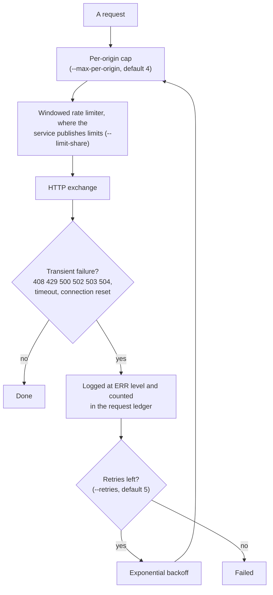
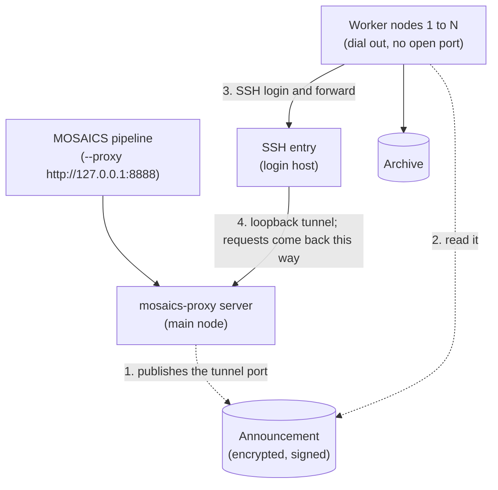

# Archive Rate Limits, Mirrors & Multi-Node Execution

Astronomical archives enforce strict per-IP concurrency limits and request-rate ceilings. MOSAICS manages archive traffic through four mechanisms: per-origin request caps, windowed rate limiters, dynamic mirror pools, and optional multi-node execution across SSH workers.

## 1. Per-origin concurrency caps and retries

Every HTTP transport in MOSAICS enforces a per-origin concurrency limit (`--max-per-origin`, default `4` concurrent requests per `scheme://host:port`) alongside global concurrency (`--concurrency` / `--workers`).

- Transient HTTP failures (`408`, `429`, `500`, `502`, `503`, `504`, timeouts, and connection resets) are retried with exponential backoff (`--retries`, default `5`, and `--timeout`).
- Every failed HTTP exchange—even one that a subsequent retry recovers—is logged at `ERR` level and counted in the per-service request ledger so archive instability is visible in logs and run reports.
- Services that publish explicit windowed rate limits (such as the Rubin Science Platform’s 1,000 requests per minute and 12 concurrent queries) are paced by a sliding-window rate limiter (`--limit-share`, default `0.85`).

Astro Data Lab’s public TAP publishes no limits, so the `adl-healpix` adapter keeps to the conservative end of what was observed: at most 30 requests a minute and two at a time, at most 50 index ranges in a query (100 or more time out) and 50,000 rows back. It asks for nothing that needs a login, and no response header ever asked it to slow down. Details, and the cost of a match, are in [Data Lab without a login](datalab-healpix.md).

## 2. Dynamic mirror load balancing

Many HiPS surveys and the CDS `hips2fits` service are replicated across multiple international mirrors (CDS Strasbourg `alasky` and `alaskybis`, Harvard CfA, CADC, STScI, etc.).

- Before a HiPS cutout run begins, MOSAICS reads the survey’s mirror list from the CDS MocServer registry and sends one lightweight validation probe to every candidate mirror.
- Surviving mirrors enter a live pool scored by `(in_flight + 1) * latency_ewma`. Each request is dispatched to the lowest-scored mirror.
- If a request fails on one mirror—even with a permanent HTTP error—the engine immediately re-attempts it on an untried mirror before backing off, temporarily benching mirrors that fail repeatedly.
- Pass `--no-mirrors` on `mosaics-cutout` to pin all requests to the primary host when debugging a specific server.

## 3. Single-node vs. multi-node execution (`mosaics-proxy`)

Because archive rate limits are enforced per source IP address, a single machine is bounded by one IP’s quota. When other machines can lend their connection (cluster login nodes, cloud instances, workstations of collaborators), `mosaics-proxy` turns them into a distributed outbound request pool. A worker dials out to the pool and needs no open port; the pipeline only sees an ordinary HTTP proxy on the main node.

1. **Main node (`mosaics-proxy server`):** Runs locally, accepts HTTP proxy requests from any MOSAICS pipeline (`--proxy http://127.0.0.1:8888`), and schedules each request onto a remote node that has spare capacity for that target archive origin. With `--announce` it publishes where workers can reach it, so a worker started with only a name finds it.
2. **Remote nodes (`mosaics-proxy worker`):** Each reads the announcement, logs in to the SSH entry it names and opens a forward to the server’s loopback tunnel port, so the connection runs worker → SSH entry → tunnel → server and the worker needs no inbound port. The server then monitors it through the `heartbeat@mosaics` SSH subsystem. The scheduler tracks each node’s live goodput (bytes/s), connection latency, and error rate per archive origin, ordering available nodes by health without ever exceeding `--max-per-origin` on any single node.
3. **Graceful draining:** Sending `SIGTERM` to a worker or `POST /drain?worker=<id>` to the server’s stats port drains in-flight requests cleanly without dropping active downloads. If a node disconnects before the first response byte arrives, the server transparently re-places the request on another node.
4. **Who carried what:** each worker has a name and reports a machine identity; the server keeps a ledger of sessions, and `mosaics-proxy workers` prints each name’s contribution. A report from a multi-node run lists its nodes by name.

The commands, the announcement and the ledger are in the [`mosaics-proxy` reference](../cli/proxy.md). To lend a machine as a collaborator, see [Run a worker](../getting-started/run-a-worker.md).
