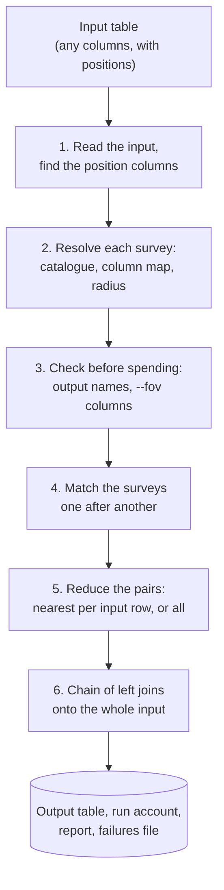
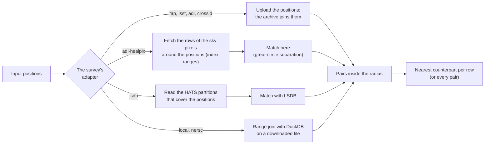
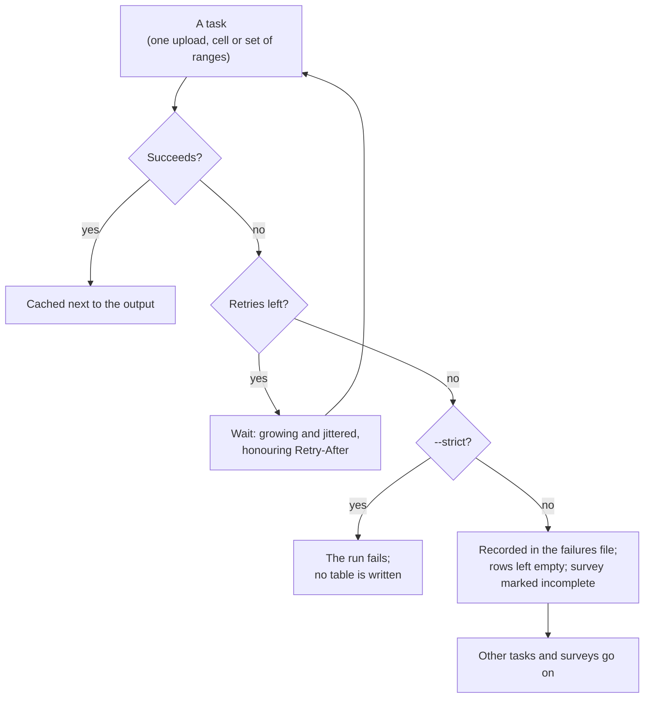

# Crossmatching a table of positions

`mosaics-crossmatch run` takes **a table of positions** (a CSV, Parquet, FITS or VOTable file, any columns) and **one or more surveys**, and writes the table back with each survey’s columns joined on. This page explains what a run does, how a survey says how it is to be matched, which adapter finds the pairs, and what to do when part of a run fails. The flags are in the [command reference](../cli/crossmatch.md) and the files it writes in the [output schema](../data-model/crossmatch.md).

## What a run does

1. **Reads the input** and finds its position columns (`--ra-col`, `--dec-col`, or inferred). A row without a finite position is never sent anywhere and comes back unmatched.
2. **Resolves each survey** from the roster (the survey files named by `--survey` or by `surveys:` in a job file, less `exclude:`): its catalogue, its `column_mapping`, its radius.
3. **Checks before it spends anything.** The columns every survey will add are settled, and two surveys (or a survey and the input) claiming one output name are refused; so is `--fov` on a survey that does not add the columns it needs. The only requests sent at this point list a table’s columns.
4. **Matches the surveys one after another.** Each survey’s matching is cut into **tasks**, each owning some of the input rows; a task is one upload, one cell, one set of index ranges. Finished tasks are cached beside the output.
5. **Reduces the pairs.** Every pair inside the radius is found; the nearest counterpart is kept per input row (`--all-matches` keeps every pair, for one survey).
6. **Joins the result onto the whole input** as a chain of left joins, so an input row never moves, and writes the table, the run account, the report and, if a task failed, the failures file.



Only `(key, ra, dec)` leaves your machine. The archive’s columns are joined back onto the full input here.

## The survey’s `crossmatch` section

A survey file describes how it is matched in its `crossmatch` section, next to the `column_mapping` that names the columns it brings:

```yaml
crossmatch:
  radius: 3 arcsec
  radius_note: PSF FWHM 6.1 to 12.0 arcsec in W1-W4; positions of high-S/N sources accurate to 50 mas.
  strategy: upload        # or: extract
  moc: allwise-moc.fits   # optional footprint, for --filter-moc
```

- **One radius per survey.** The radius is a property of the survey’s depth and astrometry, so it lives with the survey and carries the note saying what it rests on. A match uses the survey’s radius (the *library* value), unless a job’s `overrides:` changes it or `--radius` names one for a single survey. The report says which of the three it used.
- **Prefixes.** The survey’s columns come behind its prefix (`wise_mag_w1`), followed by `<prefix>_dist_arcsec`, the separation to the counterpart, and `<prefix>_nmatch`, how many counterparts lay inside the radius. `--prefix` changes a prefix for one survey and `--no-prefix` removes them (two surveys then may not share a column name).
- **Columns.** `column_mapping` maps remote column names to aliases and the loader adds the prefix. A key may be a pattern: `'[ugriz]pmag': mag_psf_{1}` selects the five columns and names each with the letter it matched. Patterns need the table’s column list, so they work where an archive can be asked for it; `--columns` replaces the map for one survey with remote names or patterns.
- **Strategy.** `upload` sends the positions to the archive and gets the pairs back. `extract` is for a small catalogue, or for a selection that joins several tables and so cannot be an upload join: it fetches the survey’s rows over each occupied HEALPix cell and the cells touching it, once, and matches here. An extract that reaches the service’s row cap fails that cell and names the cap; it never falls back to uploading silently.

A spectroscopic survey is matched through its `target_selection` query, so its quality cuts apply and the columns are the query’s aliases.

## Which adapter finds the pairs

The adapter is the `adapter` of the survey’s catalogue entry. You change it with `overrides:` in a job file, or with an extension file that extends the library file and replaces the `catalog` list.

| Adapter          | How the pairs are found                                                                                                    | Needs                                                                                          |
|------------------|----------------------------------------------------------------------------------------------------------------------------|------------------------------------------------------------------------------------------------|
| `tap`, `lsst`    | The positions are uploaded to a TAP service and joined there.                                                              | the service; a token for Rubin (`LSST_TOKEN` or `--lsst-token`)                                |
| `adl`, `crossid` | The positions are uploaded to Astro Data Lab or SkyServer and joined there.                                                | a login (`DATALAB_USER`, `DATALAB_PASSWORD`); Data Lab accounts can no longer be authenticated |
| `adl-healpix`    | Rows in the sky pixels around the positions are fetched from Data Lab’s public TAP by index range; the match is made here. | nothing; see [Data Lab without a login](datalab-healpix.md)                                    |
| `lsdb`           | A partitioned (HATS) catalogue is read partition by partition and matched with LSDB.                                       | the catalogue’s location                                                                       |
| `local`, `nersc` | A catalogue downloaded once is matched on this machine with DuckDB.                                                        | disk for the file                                                                              |



Credentials are never read from YAML.

## Footprints

`mosaics-crossmatch moc --survey X -o X-moc.fits` builds a survey’s footprint as a Multi-Order Coverage map from its footprint table. `run --filter-moc` then leaves rows outside it out of the upload: they cannot match, and the archive is spared the bytes. The report counts them.

## When part of a run fails

An individual task is allowed to fail. After its retries (with a growing, jittered wait that honours `Retry-After`), the task is recorded, its rows are left empty for that survey, the survey is marked **incomplete** in the account and the report, and the other tasks and surveys go on. The failed tasks are listed in `<stem>.failures.parquet`.



Running the same command again repeats only what is missing, because finished tasks are cached next to the output, under `.mosaics-crossmatch/<output-stem>/`. `--overwrite-cache` ignores the cache. `--strict` turns a failed task into a failed run instead, and no table is written.

## Limits of the archives

Each archive’s published or observed limits are enforced in the run, not left to retries: windowed rate limiters for Rubin and the public Data Lab TAP, a per-host cap on concurrent requests (`--workers`, `--limit-share`), and an upload sized from a real measurement rather than assumed (Rubin caps one upload near 33 MB). See [archive limits](archives.md). Every request, retry and wait is counted, and the report shows what each survey cost its archive.

## Extending a shipped survey for a crossmatch

The shipped survey files are a library you extend rather than edit. To match `wise` at 2 arcseconds against your own copy of a table, write a survey file that extends it:

```yaml
# my_wise.yaml
extends: surveys/wise.yaml
crossmatch:
  radius: 2 arcsec
catalog:
  - name: wise
    type: photometric
    adapter: tap
    adapter_params:
      service: https://example.org/tap
      table: my.allwise_copy
```

and name it: `mosaics-crossmatch run --survey my_wise -i targets.csv -o out.parquet`. The slug stays `wise`, so the columns keep their prefix. The same changes can be made for one run with `overrides:` in a job file, which is what the recipes show.

## Seeing the effective configuration

Every run logs the configuration it ended up with: the job files in play, each argument with where its value came from (default, flag or a file), and the survey definitions after the overrides, with what each override changed. The run account stores the same, so the report can say it.
