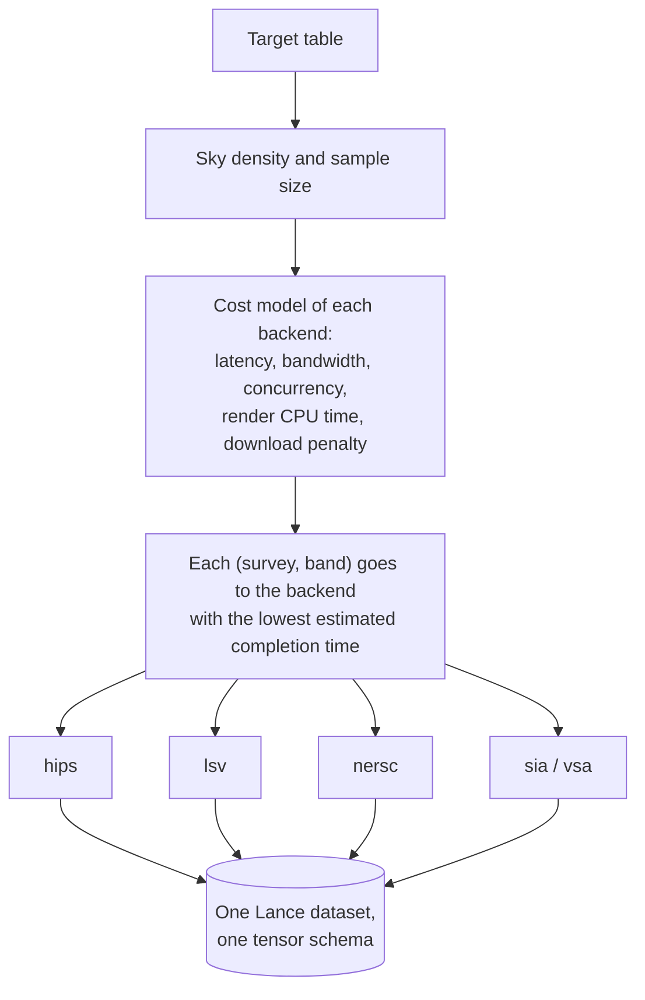

# Cutout Backends & Routing

MOSAICS provides five interchangeable backends for image cutouts (`mosaics-cutout`), plus the `full` router that combines them across surveys and bands into a single Lance dataset. All backends write the exact same Arrow tensor schema and calibration metadata, so downstream training code never needs to know which backend produced a stamp.

## 1. The five backends

| Backend          | How it works                                                                                                                                                                                              | Network cost                                                                                | Best for                                                                                                |
|------------------|-----------------------------------------------------------------------------------------------------------------------------------------------------------------------------------------------------------|---------------------------------------------------------------------------------------------|---------------------------------------------------------------------------------------------------------|
| `hips` (service) | Requests rendered FITS/JPEG/PNG stamps from the CDS `hips2fits` web service (load-balanced across `alasky` and `alaskybis`).                                                                              | 1 HTTP request per target & band                                                            | Sparse target lists ($N \lesssim 10^4$) across any HiPS survey.                                         |
| `hips --local`   | Downloads HEALPix HiPS tiles from the survey’s mirror pool into `~/.cache/mosaics/hips` and renders TAN-projected cutouts locally.                                                                        | 1 download per unique sky tile (shared across neighbouring targets)                         | Dense or large target lists ($N \gtrsim 10^4$); verified to agree with `hips2fits` to float round-off.  |
| `lsv`            | Queries the Legacy Survey Viewer `fits-cutout` / `jpeg-cutout` HTTP API (`legacysurvey.org/viewer`).                                                                                                      | 1 HTTP request per target (multi-band FITS stack returned in one call)                      | Medium runs on Legacy Survey (`ls-dr10`, `ls-dr11`), `ps1`, `hsc-dr3`, `sdss`, `galex`, `unwise-neo11`. |
| `nersc`          | Downloads Legacy Survey $0.25^\circ \times 0.25^\circ$ brick coadds (`3600x3600` pixels) from the NERSC portal into `~/.cache/mosaics/bricks` and reprojects locally.                                     | 1 brick download per band covering all targets in that $0.25^\circ \times 0.25^\circ$ brick | Large or clustered Legacy Survey DR11 runs where many targets share bricks.                             |
| `sia` / `vsa`    | Queries an IVOA Simple Image Access (`sia`) or VISTA Science Archive (`vsa`) endpoint for science frames overlapping each target, caches the frames in `~/.cache/mosaics/fields`, and reprojects locally. | 1 metadata query + cached frame downloads                                                   | Surveys served only over SIA/VSA (`ukidss10`, `ukidss11`, `vhs5`, `viking`, `hst2`, `galex`).           |

## 2. Spatial sorting for cache locality

When running a field-caching backend (`hips --local`, `nersc`, `sia`, `vsa`), nearby targets on the sky fall onto the same HiPS tiles, Legacy Survey bricks, or SIA science frames. Processing targets in random order would thrash the LRU disk cache (`--cache-size-gb`). MOSAICS therefore sorts targets spatially by HEALPix index before batching so that a cached tile or brick serves every target inside it before eviction.

## 3. How `mosaics-cutout full` routes bands



Several surveys declare more than one cutout backend in `defs/surveys/<slug>.yaml` (for example, `ls11` declares both `lsv` and `nersc`, and `ps1` declares both `lsv` and `hips`). When you run `mosaics-cutout full`:

1. It inspects the target list’s sky density and sample size together with each backend’s cost model (latency, bandwidth, concurrency, render CPU time, and per-GB download penalty).
2. It assigns each requested `(survey, band)` to the backend with the lowest estimated wall-clock completion time (or honours `--local` for HiPS surveys).
3. Pass `--plan` to print the chosen backend, pixel calibration unit, and estimated runtime for every `(survey, band)` without downloading any data:

```console
$ uv run -m mosaics.cli.cutout full -t test/objects_sample_1k.csv -o cutouts.lance --config defs/cutout.yaml --plan
```

## 4. Pixel calibration metadata

Each cutout column (`cutout_<slug>_<band>`) records its physical calibration in the Arrow field metadata:

- `nanomaggy`: linear flux density where $m_{\text{AB}} = 22.5 - 2.5 \log_{10}(\text{flux})$ (`ls10`, `ls11`, `sdss20`, `unwise`).
- `ab_zeropoint` / `counts_per_s`: linear counts with a survey-wide AB zero point stored in `mosaics_scale` and `mosaics_offset` (`galex`, `hsc3`, `skymapper4`).
- `unknown`: uncalibrated display tiles (RGB `color` HiPS or per-frame zero points such as `vsa`/`sia`).
