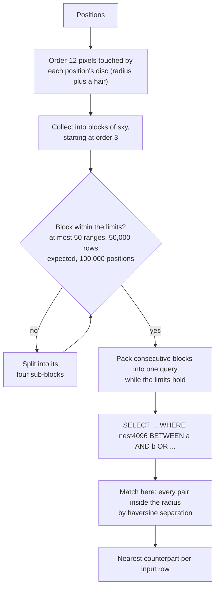
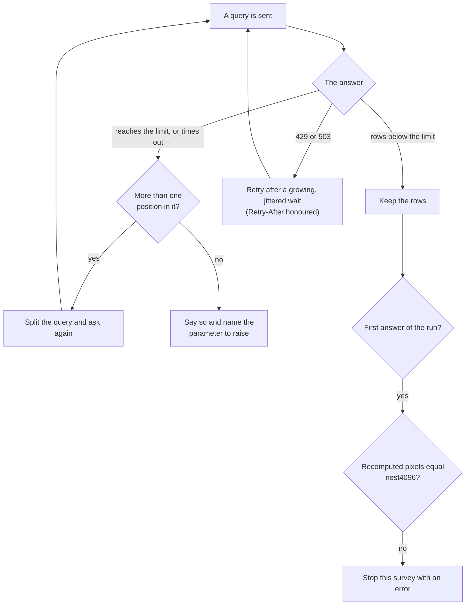

# Data Lab without a login: matching by index ranges

Astro Data Lab’s large tables (`gaia_dr3.gaia_source`, `allwise.source`, `ukidss_dr11plus.lassource`, `ls_dr11.tractor`, …) can be matched against a table of positions in two ways. The first uploads the positions to the archive and lets it join them, which needs a Data Lab account; accounts can no longer be authenticated, so that route is closed. The second, the **`adl-healpix`** adapter, needs neither a login nor an upload: it asks the archive’s public TAP for the rows that lie in the sky pixels around the positions, and does the match on your machine. Since 2026-10-20 it is the route `wise`, `gaia3` and `ukidss11` ship with, and the way `ls11` is reached through Data Lab.

## The idea

Each of these tables carries a column, `nest4096`, holding the HEALPix NESTED index of the row’s position at order 12 (4096 pixels along a base-pixel side, about 52 arcseconds across). The neighbours of a position are the rows whose index lies in a short list of ranges, so the archive is asked

```sql
SELECT <columns> FROM <table> WHERE nest4096 BETWEEN a AND b OR nest4096 BETWEEN c AND d OR ...
```

and nothing else: the anonymous service accepts neither an upload nor a spatial function, but it answers this. What comes back is a **superset** of the true matches, namely every row of every pixel the query covers. The match proper is made afterwards on your machine: every pair closer than the survey’s radius, by great-circle (haversine) separation, is kept, and the nearest counterpart is chosen from those exactly as for any other adapter. The adapter’s answer is therefore exact; the archive’s only job is to return enough rows.

## How the positions are grouped

One request per position would be hopeless, so the planner groups the positions and writes the ranges for each group:

1. The sky pixels the positions’ discs (the radius plus a hair) touch are found at order 12.
2. Positions are collected into blocks of sky, starting from large pixels (order 3). A block whose discs cover more than half of its pixel is asked for whole as one range; neighbouring ranges are merged when the rows expected in the gap between them are few.
3. A block becomes a query only if it respects three limits: at most **50 ranges** (the public TAP times out well above that), at most **50,000 rows** expected, and at most 100,000 positions; otherwise it is split into its four sub-blocks. Consecutive blocks are then packed into one query while they stay within the limits, so a sparse input makes few requests with many small ranges, and a dense one makes few requests with whole-pixel ranges.
4. The rows expected per query come from the table’s density: the `rows_per_deg2` parameter when the survey file gives it, otherwise a count of the rows in the busiest (at most **eight**) sky cells of the input, kept so that a rerun asks nothing. The density only sizes the queries; the plan is exact whatever it is.



The plan is saved beside the results, so a rerun or a resume asks the same questions and repeats only what is missing.

## What can go wrong, and what the adapter does about it

- **A query returns its limit.** The answer is never trusted: the query is split into smaller ones and asked again. If one position’s own neighbourhood holds more rows than the limit, the run says so and names the parameter to raise.
- **A query times out.** It is handled like a truncation, since asking again unchanged fails again.
- **The index is wrong.** On the first answer of each run the adapter recomputes the HEALPix pixel of the returned positions and compares it to `nest4096`. If any differ the survey is stopped with an error rather than risk missed matches. (This is why a table whose index column is mislabelled is safe to name: the run refuses it.)
- **The service is busy.** Requests are paced at **30 a minute, two at a time**. A crossmatch run matches its surveys one after another; in a targets run, where several steps can be in flight, every `adl-healpix` survey shares one allowance for the host. A 429 or 503 is retried with a growing, jittered wait that honours `Retry-After`; every failed attempt is logged as an error and counted in the request ledger.



## Cost

Measured against the public TAP on 2026-10-20, matching within 5 arcseconds:

| Input                               | Table                  | Requests                  | Time                             |   Rows returned |   Pairs |
|-------------------------------------|------------------------|---------------------------|----------------------------------|-----------------|---------|
| 1,000 positions in a 10 deg² field  | `allwise.source`       | 9                         | 34 s                             |          64,857 |      67 |
| 10,000 positions in a 10 deg² field | `allwise.source`       | 7                         | 20 s                             |         147,992 |     813 |
| 1,000 positions spread over the sky | `allwise.source`       | 22 plus 48 density counts | 28 s plus about 11 min of counts |          17,124 |     122 |
| 10,000 positions in a 10 deg² field | `gaia_dr3.gaia_source` | 4                         | 11 s                             |          42,562 |     224 |

The price of a match is bytes, not requests: most rows returned are neighbours of a position in the same 52-arcsecond pixel, so between 0.1 % and 0.5 % of them become pairs. A sparse whole-sky input spends most of its requests on density counts, which is why they are capped at eight and why giving `rows_per_deg2` removes them. The report of a crossmatch shows, per survey, the queries sent, the ranges, the rows returned against the pairs found (the efficiency), the splits after a truncation and the limiter’s state.

## Looking before sending

`mosaics-crossmatch run --dry-run` prints, for each `adl-healpix` survey, the plan it would send: the number of queries, ranges, positions per query, the rows expected and the minutes the requests would take at the pace above. It sends nothing; with no `rows_per_deg2` it assumes a typical density and says so.

## Using it

In a survey file the adapter is a catalog entry:

```yaml
catalog:
  - name: gaia3
    type: photometric
    adapter: adl-healpix
    adapter_params:
      table: gaia_dr3.gaia_source
      rows_per_deg2: 44000      # optional: skips the density counts
```

The table needs an index column (`index_column`, default `nest4096`, of order `index_order`, default 12), a pair of position columns (found by their UCD, or named with `remote_ra_column` and `remote_dec_column`) and nothing else; the keys are in the [configuration reference](../configuration/index.md).

To reach `ls11` this way, name the extension file instead of the library file; it swaps `ls11`’s catalog for `ls_dr11.tractor` and leaves everything else of the survey as it is:

```console
$ uv run -m mosaics.crossmatch.cli run --survey extensions/ls11-datalab -i targets.csv -o matched.parquet --fov ls11
```

It is for `mosaics-crossmatch` and `mosaics-fov`; the targets pipeline reads the Legacy Survey sweeps from NERSC for its own `ls11` extraction.

### In the targets pipeline

`mosaics-targets` runs the `adl-healpix` crossmatches the way it runs the others: one sky-cell store per survey (`augment/adl-healpix/<slug>`), filled cell by cell, a failed cell recorded and retried with `--retry-failed`. Nothing is uploaded and no login is needed. The cells of one survey are matched one after another, the queries of a cell side by side, and the survey shares the cap on steps per archive (`--steps-per-source`) with the other Data Lab steps. The store holds what the upload route’s holds: the Legacy Survey identifier, the survey’s columns under their prefix and the separation, so the catalogue is built from it unchanged.
