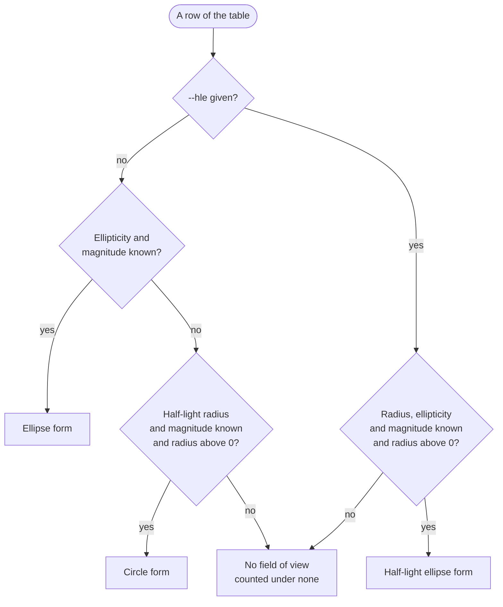

# Field of view: the size of a galaxy’s cutout

The **field of view** (`fov`) of a galaxy is the edge, in arcseconds, of the square cutout that frames it. It is the number that lets one dataset hold a faint compact galaxy and a bright extended one at a useful scale: the cutout of each is as wide as the galaxy needs, and the pixel scale varies with it. The targets catalogue carries it as the `fov` column, and `mosaics-cutout` reads it back to decide how much sky to request for each target.

Three commands compute it, with one set of numbers: `mosaics-targets` (the catalogue’s `fov`), `mosaics-crossmatch run --fov SURVEY` (a column added after a match) and [`mosaics-fov`](../cli/fov.md) (any table).

## What it needs

The model is calibrated on the **Legacy Survey `r` band**, so its inputs are the Legacy Survey Tractor measurements of the galaxy:

| Column                 | Meaning                                                                                                                                                                                                                                                  |
|------------------------|----------------------------------------------------------------------------------------------------------------------------------------------------------------------------------------------------------------------------------------------------------|
| `shape_r`              | half-light radius of the galaxy model, arcseconds                                                                                                                                                                                                        |
| `shape_e1`, `shape_e2` | the two ellipticity components of the galaxy model                                                                                                                                                                                                       |
| `mag_r`                | extinction-corrected `r` magnitude, or `flux_r` (model flux, nanomaggy) together with `mw_transmission_r` (Galactic transmission, linear, 0 to 1), from which it is made as $m_r = 22.5 - 2.5\log_{10}(\texttt{flux\_r} / \texttt{mw\_transmission\_r})$ |

A flux that is zero or negative, or a transmission that is not positive, has no magnitude. In the catalogue the columns are `ls11_shape_r` and so on; `mosaics-crossmatch` finds them under the survey’s prefix (or bare when the run has no prefix), and `mosaics-fov` under `--prefix`.

## The three methods

Let $e = \min(\sqrt{e_1^2 + e_2^2},\; e_\mathrm{max})$ with $e_\mathrm{max} = 0.6$ (`--max-e`), so a near-degenerate fit cannot set the size. $c_\mathrm{ell}(m_r)$ and $c_\mathrm{circ}(m_r)$ are the correction factors of the ellipse and the circle, read from a table by $r$ magnitude that ships with MOSAICS (see [the correction factors]()).

| Method                 | What it measures                                                                                                                                                                                                                                                                                                                        | When it is used                                                   |
|------------------------|-----------------------------------------------------------------------------------------------------------------------------------------------------------------------------------------------------------------------------------------------------------------------------------------------------------------------------------------|-------------------------------------------------------------------|
| **Ellipse**            | the bounding box of the ellipse that $e_1$ and $e_2$ describe, with the ellipse’s factor $c_\mathrm{ell}(m_r)$; $\mathrm{fov} = 2\,B\,c_\mathrm{ell}(m_r)$ converted to arcseconds, $B$ being the larger side of the bounding box of the ellipse of axes $1+e$ and $1-e$ at the position angle of the components ($B = 1$ when $e = 0$) | the default, wherever the ellipticity and the magnitude are known |
| **Circle**             | twice the half-light radius with the circle’s factor; $\mathrm{fov} = 2\,\texttt{shape\_r}\;c_\mathrm{circ}(m_r)$                                                                                                                                                                                                                       | the default, only for a row with no usable ellipse                |
| **Half-light ellipse** | the bounding box of the half-light ellipse of the galaxy model, scaled by the circle’s factor (below)                                                                                                                                                                                                                                   | only when asked for (`--hle`)                                     |

Two things are worth knowing about the first two:

- **The ellipse form ignores `shape_r`.** Two galaxies with the same ellipticity and magnitude get the same size whatever their half-light radius.
- **The circle form ignores the ellipticity.** An edge-on disc and a round galaxy of one radius and magnitude get the same square.



### The half-light ellipse

The Legacy Survey Tractor catalogue describes a galaxy model by `shape_r`, `shape_e1` and `shape_e2`. In its documentation the ellipticity is the complex number $\varepsilon = \varepsilon_1 + i\,\varepsilon_2$: its modulus sets the axis ratio, $b/a = (1 - |\varepsilon|)/(1 + |\varepsilon|)$, and its phase the orientation of the major axis, $\varphi = \tfrac{1}{2}\arctan(\varepsilon_2/\varepsilon_1)$. `shape_r` is the half-light radius, and in the model it is the **semi-major axis** of that ellipse: the half-light ellipse has semi-axes $a = \texttt{shape\_r}$ and $b = \texttt{shape\_r}\,(1-e)/(1+e)$.

The half-light radius is not the radius that frames the galaxy. The circle’s correction factor turns it into the one that does, $a' = c_\mathrm{circ}(m_r)\,\texttt{shape\_r}$, and this method frames the ellipse that has $a'$ as its semi-major axis and the same axis ratio and orientation:

$$
b' = a'\,\frac{1-e}{1+e}, \qquad
\mathrm{fov} = 2\,\max\!\Big(\sqrt{a'^2\cos^2\varphi + b'^2\sin^2\varphi},\; \sqrt{a'^2\sin^2\varphi + b'^2\cos^2\varphi}\Big)
$$

The square is the larger side of the ellipse’s bounding box. A round galaxy ($e = 0$) gets exactly the circle’s size, and an ellipse lying along an axis ($\varepsilon_2 = 0$) gets $2a'$: the edge is never longer than the corrected major axis. The ellipse’s own factor $c_\mathrm{ell}$ plays no part: only the radius is corrected, so there is no second fit to make.

With `--hle`, **only** this method is used: a row with a half-light radius but no ellipticity (which the default would size with the circle) has no field of view. Choose the flag for a dataset in which the half-light radius should set the scale; leave it off to keep catalogues comparable with the ones built before it existed.

### Which method a row gets

By default each row takes the ellipse where it can and the circle where it cannot. A row is counted under the form it took, and under `none` when it took neither. The counts always list the four keys `ellipse`, `circle`, `half-light ellipse` and `none`; the forms the method does not use are zero.

### The correction factors

The factors that turn a size into the edge of the cutout come from a table by $r$ magnitude, one column for the ellipse and one for the circle, calibrated on Legacy Survey cutouts. Each column is read in one of two ways (`--interp`):

- `step` uses the value of the magnitude’s own bin (the row of the integer magnitude);
- `linear`, the default, interpolates between the middles of the bins, so the value in the table is the factor at the magnitude plus one half.

Outside the table’s range of 8 to 19 the factor of the nearest end is used, and a missing magnitude gives no field of view.

## Rows without a value

A row has **no field of view** when an input is missing or not finite, when no magnitude can be made from its flux, or when its size comes out as **zero**. A zero size arises from a half-light radius of zero with no ellipse to fall back on: no cutout of zero edge can be requested, so the value is empty rather than `0`.

A row with a missing input and a row of size zero are both empty, but the catalogue treats them differently, because the second one is a measurement (the object has no extent) and the first is the lack of one:

| Command                        | A row with a missing input                                                    | A row of size zero               |
|--------------------------------|-------------------------------------------------------------------------------|----------------------------------|
| `mosaics-fov`                  | is kept with an empty `fov`; `--drop-missing` leaves it out                   | the same                         |
| `mosaics-crossmatch run --fov` | is kept with an empty `fov` (so is every input row the survey did not match)  | the same                         |
| `mosaics-targets`              | is dropped from the catalogue, before the train/validation/test split is made | is **kept**, with an empty `fov` |

Both are counted under `none` in the report. `mosaics-cutout` fills every empty `fov` (and every value that is not above zero) with a default before it requests anything: the value of `--default-fov`, in the unit of `--fov-unit`, or, when it is not given, the **median of the valid `fov` values** of the table it reads. It logs how many targets got the default and which value. A table without any valid `fov` needs `--default-fov`.

## What each command writes

- The column is called `fov` (`--column` renames it in `mosaics-fov`), `float32`, in **arcseconds**, and a FITS or VOTable output carries its unit.
- Each command logs how many rows took each form. The crossmatch account records them with the method (`ellipse-or-circle` or `half-light-ellipse`), and the targets report shows them in the composition of the catalogue.
- `mosaics-crossmatch run --fov SURVEY` needs the survey to be one of those matched and to add the shape and magnitude columns; otherwise it is refused before any request. An input that already has a `fov` column is refused.

## Running it

```console
$ uv run -m mosaics.fov.cli -i matched.parquet -o with_fov.parquet --prefix ls11
$ uv run -m mosaics.fov.cli -i matched.parquet -o with_fov.parquet --prefix ls11 --hle
$ uv run -m mosaics.crossmatch.cli run --survey extensions/ls11-datalab -i targets.csv -o matched.parquet --fov ls11
$ uv run -m mosaics.cli.targets --output out/ --hle
$ uv run -m mosaics.cli.cutout lsv -t targets.parquet -o lsv_grz.lance --layer ls-dr11 --bands grz --size 96 --fov-unit arcsec --default-fov 30
```

The second line sizes the table with the half-light ellipse alone; the third matches against `ls11` through Astro Data Lab’s public TAP (see [Data Lab without a login](datalab-healpix.md)) and adds `fov` from the match; the fourth builds the catalogue with the half-light ellipse; the fifth cuts out a table in arcseconds and gives every target without a field of view 30 arcseconds.

#### WARNING
`fov` is in **arcseconds**, and `mosaics-cutout` reads its field-of-view column in **arcminutes** unless told otherwise. Pass `--fov-unit arcsec` when cutting out targets from a table made by any of these commands, or every cutout will be sixty times too wide. `--default-fov` is in the same unit as the column (`--fov-unit`).

## Choosing the method for a catalogue

The default keeps every catalogue built so far valid. The half-light ellipse is a different size model: switching a catalogue to it changes the `fov` of every row, so the cutouts built from the old values no longer frame the same sky, and the choice belongs in the dataset’s documentation. `mosaics-targets --hle` changes nothing that was fetched, only the size column and which rows survive (a row needs all of `shape_r`, `shape_e1`, `shape_e2` and the magnitude), so it is a cheap change to try.
