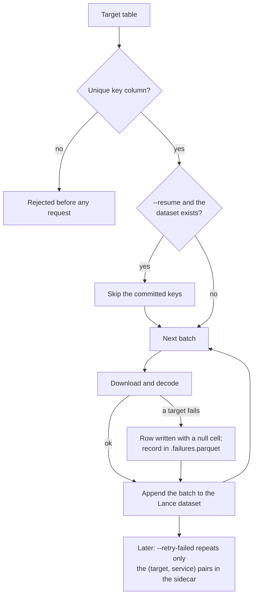

# Long Runs, Resume & Failure Sidecars

Astronomical extractions routinely span hundreds of thousands to tens of millions of targets and run for hours or days. MOSAICS is designed around the assumption that **runs will be interrupted** and **individual targets will fail**.

## 1. Batched commits and `--resume`

Every cutout and spectrum extraction divides the target table into batches (`--batch-size`, default `256` for cutouts and `512` for spectra). As soon as a batch finishes downloading and decoding, it is appended to the output Lance dataset on disk before the next batch begins.



- **Unique key requirement:** Every run requires a unique target identifier column (`--id-col`, defaulting to `id`, or a generated `mosaics_id` column when `--id-col` is omitted and no `id` column is present). Duplicate keys in the input table are rejected immediately before any requests are sent, because `--resume` relies on the key column to determine which targets are already stored.
- **Resuming (`--resume`):** Passing `--resume` inspects the existing Lance dataset, reads the committed key values, and skips those rows so work continues from the first uncommitted batch.

```console
$ uv run -m mosaics.cli.cutout hips -t test/objects_sample_1k.csv -o cutouts.lance --hips-id CDS/P/PanSTARRS/DR1/g --resume
```

## 2. In-band failures and the `.failures.parquet` sidecar

A failed request or corrupt archive file never aborts a batch or a run. Instead:

1. The row is still written to the Lance dataset in its batch, with an Arrow `null` in the affected image or spectrum column(s).
2. A structured failure record is appended to `<output>.failures.parquet` beside the Lance dataset, recording the target key, the service label (`<survey>:<adapter>:<band>`), the HTTP status or error category, and the failure message.

## 3. Retrying failed targets (`--retry-failed`)

Once a run finishes, you can re-attempt only the failed `(target, service)` pairs recorded in `<output>.failures.parquet`:

```console
$ uv run -m mosaics.cli.cutout full -t test/objects_sample_1k.csv -o cutouts.lance --retry-failed --fill-missing rewrite
```

- For **cutouts**, `--fill-missing` controls how recovered stamps are written: `null` (re-fetch only rows where the image is null) or `rewrite` (patch individual band columns in place inside the existing Lance dataset).
- For **spectra**, `--fill-missing rewrite` is refused by design: a spectrum’s columns (`flux`, `error`, `wavelength`, `mask`) are parallel variable-length arrays of a single observation and must succeed or fail as an atomic group.

## 4. Cooperative interruption (`Ctrl-C`)

Pressing `Ctrl-C` (`SIGINT`) triggers a cooperative stop across all worker threads and asynchronous downloads:

- Queued tasks are cancelled immediately without starting new HTTP requests.
- Active retry backoff sleeps and streaming file downloads terminate early.
- Interrupted tasks are **never** recorded as failed in `.failures.parquet` or sky-cell ledgers—only completed batches or settled sky cells are kept on disk, leaving the dataset clean for `--resume`.
