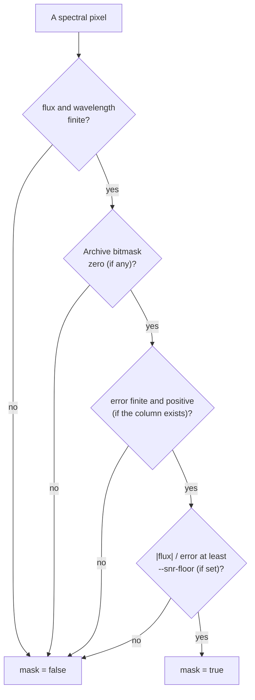

# Variable-Length Spectra & Masking

Unlike image cutouts—which have a fixed `(C, H, W)` pixel shape chosen by the user—astronomical 1D spectra have **variable sample lengths** that depend on the spectrograph, arm coverage, and observation mode. That single fact shapes how `mosaics-spectrum` stores, masks, and resumes spectral datasets.

## 1. The four spectrum adapters

Each spectroscopic survey in `defs/surveys/` declares one or more `spectra:` entries using four backends:

| Adapter        | How it fetches spectra                                                                                                                                                                                 | Surveys using it               |
|----------------|--------------------------------------------------------------------------------------------------------------------------------------------------------------------------------------------------------|--------------------------------|
| `url`          | Downloads each target’s 1D spectrum FITS file from a URL column already present in the input table (`sixdfgs_access_url`, `hst_access_url`, `euclid_access_url`).                                      | `6dfgs`, `hasp`, `euclidq1`    |
| `template`     | Builds the archive URL deterministically from target metadata columns (such as `plate`, `mjd`, `fiberid` for SDSS, `obsid` for LAMOST, or `serial` for 2dFGRS).                                        | `sdss17`, `lamost11`, `2dfgrs` |
| `sparcl`       | Queries the NOIRLab SPARCL service in batches by `targetid` (`dataset: DESI-DR1`).                                                                                                                     | `desi1`                        |
| `desi-healpix` | Downloads DESI `coadd-<survey>-<program>-<pix>.fits` HEALPix files from NERSC (`release: dr1`, `specprod: iron`), caches them locally, and splices the `B`, `R`, and `Z` spectrograph arms per target. | `desi1`                        |

## 2. Parallel arrays and atomic group semantics

For each spectroscopic survey `<slug>`, `mosaics-spectrum` writes up to four parallel Arrow `large_list` columns:

- `{slug}_flux` (`large_list<float32>`): 1D spectral flux density, scaled by `spectroscopic_system.flux_scale` when defined (standardised to $10^{-17}\ \text{erg}\ \text{s}^{-1}\ \text{cm}^{-2}\ \text{\AA}^{-1}$ for calibrated surveys).
- `{slug}_error` (`large_list<float32>`): $1\sigma$ uncertainty per spectral pixel in the **exact same unit as `{slug}_flux`**. Whether the archive publishes $1\sigma$ error (`ERROR`), variance (`VAR`), or inverse variance (`IVAR`), the decoder converts it to $1\sigma$ (`error = 1 / sqrt(ivar)` where `ivar > 0`, and `inf` where `ivar <= 0`). Surveys that publish no usable per-pixel uncertainty (`2dfgrs`, `6dfgs`) omit `{slug}_error`.
- `{slug}_wavelength` (`large_list<float32>`): wavelength per pixel in Angstroms ($\text{\AA}$).
- `{slug}_mask` (`large_list<bool>`): boolean usability mask where **`true` means usable (good pixel)** and **`false` means masked/unusable**.

Because these arrays describe the same 1D spectrum, they are guaranteed to have **identical length** on every row, and they succeed or fail as an atomic group.

## 3. Boolean `mask` and `--snr-floor`

Archive bitmasks (`and_mask`, `ormask`, `DQ`, `B_MASK`) are consumed during decoding and never written raw to the dataset. Instead, each sample’s boolean `mask[i]` is `true` if and only if all applicable conditions hold:

1. `flux[i]` and `wavelength[i]` are finite (`not NaN`, `not inf`).
2. The archive’s own per-pixel quality bitmask is zero (when the archive provides one).
3. When `{slug}_error` exists, `error[i]` is finite and positive (`error[i] > 0`).
4. When `--snr-floor` is set (e.g. `--snr-floor 2.0`) and `{slug}_error` exists, $|{\text{flux}[i]}| / \text{error}[i] \ge \text{snr\_floor}$.

## 4. `null` vs. empty list (`[]`)

In a `large_list` column, an Arrow `null` and a zero-length list `[]` mean two distinct things:

- **Arrow `null`:** The download or decode **failed** (or the target was not observed by that survey). It is recorded in `.failures.parquet` and is eligible for `--retry-failed`.
- **Zero-length list `[]`:** The spectrum was fetched and decoded, but had zero samples. `--resume` treats a zero-length list as already completed and does not re-download it.
