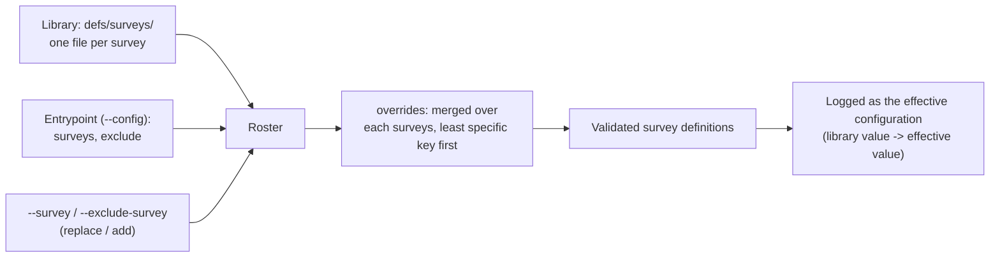
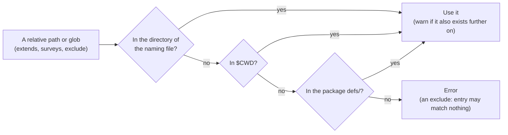
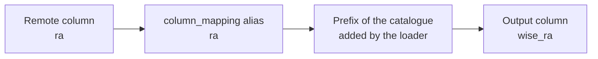

# Surveys, Entrypoints & the Prefix Rule

Every survey known to MOSAICS is described once, in a single YAML file under `defs/surveys/<slug>.yaml`. Whether you run `mosaics-cutout full`, `mosaics-spectrum`, `mosaics-targets`, or `mosaics-report db_constraints`, every pipeline reads the section it needs from that same file.

## 1. Separation of concerns inside a survey file

A survey file declares `survey_slug`, `name`, and whichever of ten independent sections apply to that survey:

| Section                | What it describes                                                                                                           | Read by                                              |
|------------------------|-----------------------------------------------------------------------------------------------------------------------------|------------------------------------------------------|
| `catalog`              | Remote or local catalogue tables (`photometric` or `spectroscopic`) and their provider adapter                              | `mosaics-targets`, `mosaics-query`                   |
| `catalog_filters`      | Post-hoc DuckDB SQL depth/redshift quality cuts applied during catalogue production                                         | `mosaics-targets`                                    |
| `cutout`               | Image cutout backends (`hips`, `lsv`, `nersc`, `sia`, `vsa`) and band lists                                                 | `mosaics-cutout full`                                |
| `spectra`              | 1D spectrum download backends (`url`, `template`, `sparcl`, `desi-healpix`)                                                 | `mosaics-spectrum`                                   |
| `photometric_system`   | Passband SVO filter IDs, Vega/AB/asinh/linear conversion rules, and image pixel calibration                                 | `mosaics-targets`, `mosaics-cutout`                  |
| `spectroscopic_system` | Fibre diameter, disperser, redshift tiebreak rank, velocity conversion, and flux calibration                                | `mosaics-targets`, `mosaics-spectrum`                |
| `target_selection`     | SQL query file (`.sql`) or HATS filter rules that seed the candidate table                                                  | `mosaics-targets`, `mosaics-report db_constraints`   |
| `column_mapping`       | Remote column to alias map for photometric crossmatching (glob keys select many columns); the loader adds the prefix        | `mosaics-targets`, `mosaics-crossmatch`              |
| `crossmatch`           | The radius a table of positions is matched within, the note saying what it rests on, an optional footprint and the strategy | `mosaics-crossmatch`, `mosaics-targets` (the radius) |
| `provides`             | Another survey’s photometry already carried inside this survey’s extraction query (e.g. `gaia3` and `unwise` inside `ls11`) | `mosaics-targets`                                    |

Because each concern lives in its own section, editing a cutout backend cannot affect target selection, and changing a post-hoc `catalog_filters` cut only rebuilds the final production catalogue without refetching any sky cells.

## 2. Entrypoint files, `surveys:` and `overrides:`

The files in `defs/surveys/` are a **library**: one declarative, unfolded file per survey. A run reads them through an **entrypoint** (`defs/*.yaml`), the file `--config` takes, which lists the survey files it covers under `surveys:` (a string or list of paths/globs, `.yaml` optional), removes some with `exclude:`, and changes some under `overrides:`. `--config` also accepts a single survey file (`defs/surveys/ps1.yaml`), which is a run of that one survey.

```yaml
# defs/custom.yaml
surveys:
  - surveys/*

exclude:
  - surveys/lsst*

overrides:
  # Disable Pan-STARRS1 cutouts in this run:
  surveys/ps1:
    cutout: []
  # Remove the VHS DR5 post-hoc magnitude cut:
  surveys/vhs5:
    catalog_filters:
      vhs5: null
```



An override key is a glob over a survey file’s name (`surveys/ps1`) or slug (`ps1`); every key that matches is merged deeply over the survey, the less specific key first. `--survey REF …` on the command line replaces the roster and `--exclude-survey REF …` adds to `exclude:`. Every run logs the effective configuration, naming each key an override changed as `library value -> effective value`.

`extends:` is a plain dictionary default and nothing else: an entrypoint extends entrypoints, and a survey file extends survey files. To change a library survey permanently for your own runs, write a survey file that extends it and list that file in place of the library one:

```yaml
# my_ps1.yaml
extends: surveys/ps1.yaml
cutout: []
```

Resolution rules:



- **Search order:** Relative paths in `extends:`, `surveys:` and `exclude:` are resolved first against the directory of the naming file, then `$CWD`, then the package `defs/` directory (deduplicated by resolved path). The first base where the path or glob matches wins; if found under multiple distinct bases, a warning is logged naming the winner and shadowed paths.
- **Recursive:** Files can extend files of their own kind to any depth. Circular extensions are detected and raise an error showing the full chain.
- **Exclusion:** An `exclude:` key removes matching files from the roster; an `exclude:` entry that matches nothing is allowed and logged at `info`.
- **Root lookup:** When passing `--config <file>`, relative paths are checked as given (in `$CWD`) and then in `defs/`, so `--config targets.yaml` works from any working directory; the repository-root spelling `--config defs/targets.yaml` resolves from anywhere too.

Shipped entrypoints in `defs/`:

- `defs/full.yaml`: globs all 30 files in `defs/surveys/*.yaml`.
- `defs/targets.yaml`: the production target-selection and crossmatch configuration.
- `defs/cutout.yaml`: all surveys with enabled cutout backends.
- `defs/lsv.yaml`: Legacy Survey Viewer cutout subset.

## 3. The prefix rule

Every column contributed by a survey catalogue carries that catalogue’s prefix so columns from different archives never collide:



- A survey with a single catalogue uses `{slug}` as its prefix (e.g. `ls11_ra`, `vhs5_mag_aper3_ks`, `sdss17_z`).
- A survey declaring **both** a photometric and a spectroscopic catalogue in the same file appends `p` and `s` (`euclidq1p_*` and `euclidq1s_*`) so both halves have distinct coordinate and ID columns.
- Cutout columns are always named `cutout_{slug}_{band}` (e.g. `cutout_ls11_g`, `cutout_delve2_color`).
- The loader validates every key and column prefix strictly at startup: an unknown YAML key, a misspelled `pixel_unit`, or a `column_mapping` alias that already starts with the survey prefix (the loader adds it, so `wise_ra` would become `wise_wise_ra`) raises an immediate configuration error.
- In `column_mapping` the prefix is never written. `ra: ra` in `wise.yaml` gives `wise_ra`; the columns a survey hosts for another (`ls11` carries unWISE fluxes) sit under a key named after that survey’s `provides` prefix and keep its prefix (`unwise_flux_w1`). A key may be a glob such as `'[ugriz]pmag': mag_psf_{1}`, where `{1}` is the text the wildcard matched; a backslash makes a wildcard character literal (`'p\*'` is the column `p*`).
