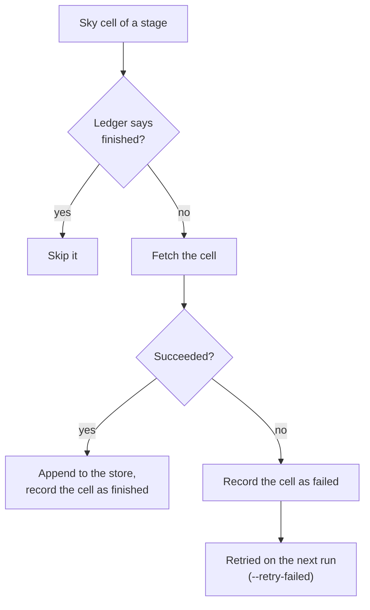
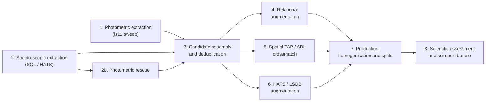

# The Targets Pipeline

`mosaics-targets` (`uv run -m mosaics.cli.targets`) builds a unified, science-ready multi-wavelength photometric and spectroscopic catalogue across the sky.

## 1. Declination sky-cell grid and resumable stores

Rather than running monolithic all-sky queries that fail after hours if a single archive hiccups, `mosaics-targets` divides the sky into declination strips (`cells`) and stores every intermediate stage in a `CellStore` (`<run_dir>/stores/<stage>/<survey>.lance` plus an append-only ledger `<survey>.ledger.jsonl` and `<survey>.store.json`).

- **Cell-level resume:** The ledger records which sky cells have finished and which failed. Re-running the same command automatically skips every finished cell and retries only pending or failed cells.
- **Configuration fingerprinting:** Each store hashes its query, column map, and selection parameters into `<survey>.store.json`. If you edit a survey’s `target_selection` SQL query, MOSAICS detects the fingerprint change and replaces only that store while keeping every unaffected store intact.
- **Declination slicing (`--dec-range`):** Pass `--dec-range MIN_DEC MAX_DEC` (in degrees, e.g. `--dec-range -5.0 5.0`) to restrict extraction to a declination strip for testing or staged production runs.

## 2. The eight pipeline stages

1. **Photometric extraction:** Queries the primary optical survey (`ls11` NERSC sweep files) cell by cell using `defs/surveys/phot_ls_dr11_full.sql`, extracting resolved primary objects (`brick_primary = 1`) plus hosted `gaia3` and `unwise` photometry.
2. **Spectroscopic extraction:** Queries every enabled spectroscopic survey (`desi1`, `sdss17`, `lamost11`, `6dfgs`, `2dfgrs`, `hasp`, `euclidq1s`) for confirmed galaxy redshifts.
3. **Photometric rescue (`ls11_rescue`):** Spectroscopic targets that fell slightly below the primary `ls11` magnitude cut are matched back against the NERSC sweeps under the relaxed `rescue_where` condition so valuable spectroscopic redshifts are not lost.
4. **Candidate assembly:** Merges the photometric and spectroscopic extractions, resolves duplicate detections within and across spectroscopic surveys using `spectroscopic_system.redshift_rank`, and writes the unified candidate anchor table (`id`, `ra`, `dec`, cell).
5. **Upload & relational augmentation:** Crossmatches the candidate anchor against remote TAP and Astro Data Lab catalogues (`gaia3`, `ukidss11`, `wise`).
6. **HATS / LSDB augmentation:** Aligns HEALPix partitions to crossmatch the candidate anchor against HATS catalogues (`denis3`, `euclidq1p`, `galex`, `hsc3`, `hst2`, `kids3`, `sdss16`, `skymapper4`, `ukidss9`, `vhs5`) and local whole-file stores (`twomass`).
7. **Production:** Joins all stores onto the candidate anchor, applies post-hoc `catalog_filters` (nulling failing survey columns without dropping rows), converts all native magnitudes (`vega_mag`, `asinh_mag`, `ab_mag`) and linear fluxes into homogenised AB magnitudes (`*_mag_*`) and microjansky fluxes (`*_flux_*`), computes dynamic field-of-view sizes (`fov`) and train/val/test spatial HEALPix splits, and writes the final catalogue.
8. **Reporting (`targets_report.yaml` & `report/`):** Profiles every stage, runs photometric closure and zero-point checks on up to 2,000,000 sampled rows, and renders the `mosaics-targets@1` `scireport` bundle (`targets_report.scireport.zip`), chapter Markdown files (`report/md/`), and PDF (`report/pdf/report.pdf`).
