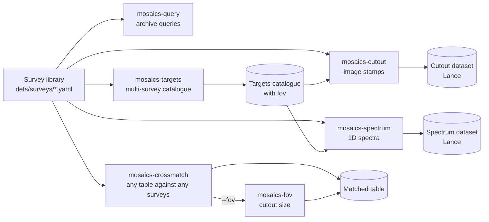

# MOSAICS

**MOSAICS** (*Massive-scale Observational Survey Acquisition and Cross-correlation System*) assembles machine-learning datasets out of astronomical archives. Given sky positions or survey selection rules, MOSAICS queries remote and local catalogues, crossmatches multi-wavelength photometry and spectroscopy, fetches calibrated image cutouts and 1D spectra, and writes the combined tables, fixed-shape image tensors, and variable-length spectral arrays into Apache Arrow / Lance datasets accompanied by reproducible `scireport` quality reports.

## The three data products

**[1. Multi-survey catalogues](concepts/targets-pipeline.md)**

Extract and crossmatch optical, UV, and infrared photometry (`ls11`, `gaia3`, `galex`, `hsc3`, `vhs5`, `wise`, `euclidq1`, …) with spectroscopic redshifts (`desi1`, `sdss17`, `lamost11`, `6dfgs`, `2dfgrs`, `hasp`, …) or Rubin/LSST Data Previews (`lsstdp1`, `lsstdp2`), homogenised to AB magnitudes and microjansky ($\mu\text{Jy}$) fluxes.

**[2. Calibrated image cutouts](concepts/cutout-backends.md)**

Retrieve multi-band FITS/JPEG image stamps across 17 imaging surveys via five interchangeable backends (`hips`, `hips --local`, `lsv`, `nersc`, `sia`, `vsa`) and store them as fixed-shape 3D tensors in a resumable Lance dataset.

**[3. Variable-length 1D spectra](concepts/spectra.md)**

Download 1D spectra across 7 spectroscopic surveys via four backends (`url`, `template`, `sparcl`, `desi-healpix`) into parallel `large_list<float32>` (`flux`, `error`, `wavelength`) and `large_list<bool>` (`mask`) Arrow columns.

## How the pieces fit



## Three-command tour

Run all commands from a repository checkout after `uv sync`:

```console
$ uv run -m mosaics.cli.query cone --service vizier --table "VII/250/2dfgrs" --columns SEQNUM RAJ2000 DEJ2000 z --ra 180.0 --dec 0.0 --radius 0.5 -o 2df_cone.parquet
$ uv run -m mosaics.cli.cutout full -t test/objects_sample_1k.csv -o cutouts.lance --config defs/cutout.yaml --size 64 --fov-unit arcmin
$ uv run -m mosaics.cli.spectrum sdss17 -t test/objects_sample_1k.csv -o sdss17_spectra.lance --snr-floor 2.0
```

## Documentation map

## Getting started

* [Installation & Credentials](getting-started/install.md)
  * [1. Clone and install with `uv`](getting-started/install.md#clone-and-install-with-uv)
  * [2. System packages for PDF reports](getting-started/install.md#system-packages-for-pdf-reports)
  * [3. Archive credentials](getting-started/install.md#archive-credentials)
  * [4. Download cache directories](getting-started/install.md#download-cache-directories)
* [Quickstart](getting-started/quickstart.md)
  * [1. Preview and fetch multi-survey image cutouts](getting-started/quickstart.md#preview-and-fetch-multi-survey-image-cutouts)
  * [2. Fetch 1D spectra for a target table](getting-started/quickstart.md#fetch-1d-spectra-for-a-target-table)
  * [3. Query a remote astronomical catalogue](getting-started/quickstart.md#query-a-remote-astronomical-catalogue)
  * [4. Match a table against surveys, and size its cutouts](getting-started/quickstart.md#match-a-table-against-surveys-and-size-its-cutouts)
  * [5. Build a multi-survey target catalogue](getting-started/quickstart.md#build-a-multi-survey-target-catalogue)
* [End-to-End Recipes](getting-started/recipes.md)
  * [Recipe 1: Extract calibrated optical + NIR cutouts from a custom survey subset](getting-started/recipes.md#recipe-1-extract-calibrated-optical-nir-cutouts-from-a-custom-survey-subset)
  * [Recipe 2: Resume an interrupted cutout or spectrum run and retry transient archive errors](getting-started/recipes.md#recipe-2-resume-an-interrupted-cutout-or-spectrum-run-and-retry-transient-archive-errors)
  * [Recipe 3: Crossmatch a local table against Rubin/LSST Data Preview 2 (`dp2.Object`)](getting-started/recipes.md#recipe-3-crossmatch-a-local-table-against-rubin-lsst-data-preview-2-dp2-object)
  * [Recipe 4: Run a multi-node extraction across SSH worker machines](getting-started/recipes.md#recipe-4-run-a-multi-node-extraction-across-ssh-worker-machines)
* [Run a worker](getting-started/run-a-worker.md)
  * [What the command does](getting-started/run-a-worker.md#what-the-command-does)
  * [Requirements](getting-started/run-a-worker.md#requirements)
  * [What is sent, and where it is kept](getting-started/run-a-worker.md#what-is-sent-and-where-it-is-kept)
  * [What the main node can ask of your machine](getting-started/run-a-worker.md#what-the-main-node-can-ask-of-your-machine)
  * [Stop it](getting-started/run-a-worker.md#stop-it)
  * [Where files go, and how to remove them](getting-started/run-a-worker.md#where-files-go-and-how-to-remove-them)
  * [Keep it running](getting-started/run-a-worker.md#keep-it-running)
  * [For the operator: see who is connected](getting-started/run-a-worker.md#for-the-operator-see-who-is-connected)

## Core concepts

* [Long Runs, Resume & Failure Sidecars](concepts/runs.md)
  * [1. Batched commits and `--resume`](concepts/runs.md#batched-commits-and-resume)
  * [2. In-band failures and the `.failures.parquet` sidecar](concepts/runs.md#in-band-failures-and-the-failures-parquet-sidecar)
  * [3. Retrying failed targets (`--retry-failed`)](concepts/runs.md#retrying-failed-targets-retry-failed)
  * [4. Cooperative interruption (`Ctrl-C`)](concepts/runs.md#cooperative-interruption-ctrl-c)
* [Archive Rate Limits, Mirrors & Multi-Node Execution](concepts/archives.md)
  * [1. Per-origin concurrency caps and retries](concepts/archives.md#per-origin-concurrency-caps-and-retries)
  * [2. Dynamic mirror load balancing](concepts/archives.md#dynamic-mirror-load-balancing)
  * [3. Single-node vs. multi-node execution (`mosaics-proxy`)](concepts/archives.md#single-node-vs-multi-node-execution-mosaics-proxy)
* [Surveys, Entrypoints & the Prefix Rule](concepts/surveys-and-configs.md)
  * [1. Separation of concerns inside a survey file](concepts/surveys-and-configs.md#separation-of-concerns-inside-a-survey-file)
  * [2. Entrypoint files, `surveys:` and `overrides:`](concepts/surveys-and-configs.md#entrypoint-files-surveys-and-overrides)
  * [3. The prefix rule](concepts/surveys-and-configs.md#the-prefix-rule)
* [Cutout Backends & Routing](concepts/cutout-backends.md)
  * [1. The five backends](concepts/cutout-backends.md#the-five-backends)
  * [2. Spatial sorting for cache locality](concepts/cutout-backends.md#spatial-sorting-for-cache-locality)
  * [3. How `mosaics-cutout full` routes bands](concepts/cutout-backends.md#how-mosaics-cutout-full-routes-bands)
  * [4. Pixel calibration metadata](concepts/cutout-backends.md#pixel-calibration-metadata)
* [Variable-Length Spectra & Masking](concepts/spectra.md)
  * [1. The four spectrum adapters](concepts/spectra.md#the-four-spectrum-adapters)
  * [2. Parallel arrays and atomic group semantics](concepts/spectra.md#parallel-arrays-and-atomic-group-semantics)
  * [3. Boolean `mask` and `--snr-floor`](concepts/spectra.md#boolean-mask-and-snr-floor)
  * [4. `null` vs. empty list (`[]`)](concepts/spectra.md#null-vs-empty-list)
* [The Targets Pipeline](concepts/targets-pipeline.md)
  * [1. Declination sky-cell grid and resumable stores](concepts/targets-pipeline.md#declination-sky-cell-grid-and-resumable-stores)
  * [2. The eight pipeline stages](concepts/targets-pipeline.md#the-eight-pipeline-stages)
* [Crossmatching a table of positions](concepts/crossmatch.md)
  * [What a run does](concepts/crossmatch.md#what-a-run-does)
  * [The survey’s `crossmatch` section](concepts/crossmatch.md#the-survey-s-crossmatch-section)
  * [Which adapter finds the pairs](concepts/crossmatch.md#which-adapter-finds-the-pairs)
  * [Footprints](concepts/crossmatch.md#footprints)
  * [When part of a run fails](concepts/crossmatch.md#when-part-of-a-run-fails)
  * [Limits of the archives](concepts/crossmatch.md#limits-of-the-archives)
  * [Extending a shipped survey for a crossmatch](concepts/crossmatch.md#extending-a-shipped-survey-for-a-crossmatch)
  * [Seeing the effective configuration](concepts/crossmatch.md#seeing-the-effective-configuration)
* [Data Lab without a login: matching by index ranges](concepts/datalab-healpix.md)
  * [The idea](concepts/datalab-healpix.md#the-idea)
  * [How the positions are grouped](concepts/datalab-healpix.md#how-the-positions-are-grouped)
  * [What can go wrong, and what the adapter does about it](concepts/datalab-healpix.md#what-can-go-wrong-and-what-the-adapter-does-about-it)
  * [Cost](concepts/datalab-healpix.md#cost)
  * [Looking before sending](concepts/datalab-healpix.md#looking-before-sending)
  * [Using it](concepts/datalab-healpix.md#using-it)
* [Field of view: the size of a galaxy’s cutout](concepts/field-of-view.md)
  * [What it needs](concepts/field-of-view.md#what-it-needs)
  * [The three methods](concepts/field-of-view.md#the-three-methods)
  * [Rows without a value](concepts/field-of-view.md#rows-without-a-value)
  * [What each command writes](concepts/field-of-view.md#what-each-command-writes)
  * [Running it](concepts/field-of-view.md#running-it)
  * [Choosing the method for a catalogue](concepts/field-of-view.md#choosing-the-method-for-a-catalogue)

## Command-line reference

* [`mosaics-cutout` — Image Cutout Extraction](cli/cutout.md)
  * [Subcommands](cli/cutout.md#subcommands)
  * [Examples](cli/cutout.md#examples)
  * [Targets without a field of view](cli/cutout.md#targets-without-a-field-of-view)
  * [Command-line reference](cli/cutout.md#command-line-reference)
* [`mosaics-query` — Catalogue Queries & SSA Discovery](cli/query.md)
  * [Subcommands](cli/query.md#subcommands)
  * [Examples](cli/query.md#examples)
  * [Command-line reference](cli/query.md#command-line-reference)
* [`mosaics-spectrum` — 1D Spectrum Extraction](cli/spectrum.md)
  * [Subcommands](cli/spectrum.md#subcommands)
  * [Examples](cli/spectrum.md#examples)
  * [Command-line reference](cli/spectrum.md#command-line-reference)
* [`mosaics-targets` — Multi-Survey Target Selection & Crossmatch Pipeline](cli/targets.md)
  * [Key capabilities](cli/targets.md#key-capabilities)
  * [Examples](cli/targets.md#examples)
  * [Command-line reference](cli/targets.md#command-line-reference)
* [`mosaics-crossmatch` — Match a Table Against Surveys](cli/crossmatch.md)
  * [Subcommands](cli/crossmatch.md#subcommands)
  * [Examples](cli/crossmatch.md#examples)
  * [What a run does](cli/crossmatch.md#what-a-run-does)
  * [Command-line reference](cli/crossmatch.md#command-line-reference)
* [`mosaics-fov` — Cutout Size for a Galaxy Table](cli/fov.md)
  * [What it needs](cli/fov.md#what-it-needs)
  * [How the size is chosen](cli/fov.md#how-the-size-is-chosen)
  * [Examples](cli/fov.md#examples)
  * [Command-line reference](cli/fov.md#command-line-reference)
* [`mosaics-hipscat` — Aladin HiPS Catalogue Builder](cli/hipscat.md)
  * [Examples](cli/hipscat.md#examples)
  * [Command-line reference](cli/hipscat.md#command-line-reference)
* [`mosaics-proxy` — Distributed Multi-Node Request Pool](cli/proxy.md)
  * [Subcommands](cli/proxy.md#subcommands)
  * [How a worker finds the server](cli/proxy.md#how-a-worker-finds-the-server)
  * [Worker names and identity](cli/proxy.md#worker-names-and-identity)
  * [What the server learns about a worker](cli/proxy.md#what-the-server-learns-about-a-worker)
  * [The ledger, the stats endpoint and Weights & Biases](cli/proxy.md#the-ledger-the-stats-endpoint-and-weights-biases)
  * [Secrets](cli/proxy.md#secrets)
  * [Setup without the announcement](cli/proxy.md#setup-without-the-announcement)
  * [Command-line reference](cli/proxy.md#command-line-reference)
* [`mosaics-report` — Post-Hoc Scientific Reports](cli/reports.md)
  * [Report tasks](cli/reports.md#report-tasks)
  * [Examples](cli/reports.md#examples)
  * [Command-line reference](cli/reports.md#command-line-reference)

## Data models

* [Input Table Formats & Coordinate Conventions](data-model/inputs.md)
  * [1. Supported file formats](data-model/inputs.md#supported-file-formats)
  * [2. Required columns and automatic inference](data-model/inputs.md#required-columns-and-automatic-inference)
  * [3. Optional per-target field of view (`--fov-col`)](data-model/inputs.md#optional-per-target-field-of-view-fov-col)
  * [4. Sample target files](data-model/inputs.md#sample-target-files)
* [Cutout Lance Dataset Schema](data-model/cutout-dataset.md)
  * [1. Column layout](data-model/cutout-dataset.md#column-layout)
  * [2. Arrow field calibration metadata](data-model/cutout-dataset.md#arrow-field-calibration-metadata)
  * [3. The `.failures.parquet` sidecar](data-model/cutout-dataset.md#the-failures-parquet-sidecar)
* [Spectrum Lance Dataset Schema](data-model/spectrum-dataset.md)
  * [1. Parallel `large_list` columns](data-model/spectrum-dataset.md#parallel-large-list-columns)
  * [2. Field and schema metadata](data-model/spectrum-dataset.md#field-and-schema-metadata)
* [Targets Production Catalogue Schema](data-model/targets-catalogue.md)
  * [1. Core anchor and summary columns](data-model/targets-catalogue.md#core-anchor-and-summary-columns)
  * [2. Per-survey detection flags](data-model/targets-catalogue.md#per-survey-detection-flags)
  * [3. Homogenised photometric columns](data-model/targets-catalogue.md#homogenised-photometric-columns)
  * [4. Spectroscopic survey columns](data-model/targets-catalogue.md#spectroscopic-survey-columns)
* [Crossmatch Output Schema](data-model/crossmatch.md)
  * [1. The joined table (`-o` / `--output`)](data-model/crossmatch.md#the-joined-table-o-output)
  * [2. The run account (`<output-stem>.crossmatch.yaml`)](data-model/crossmatch.md#the-run-account-output-stem-crossmatch-yaml)
  * [3. The report (`<output-stem>.report/`)](data-model/crossmatch.md#the-report-output-stem-report)
  * [4. The failures file (`<output-stem>.failures.parquet`)](data-model/crossmatch.md#the-failures-file-output-stem-failures-parquet)
* [Reading Output Datasets in Python](data-model/reading-outputs.md)
  * [1. Reading a cutout or spectrum Lance dataset with `lance` and `pyarrow`](data-model/reading-outputs.md#reading-a-cutout-or-spectrum-lance-dataset-with-lance-and-pyarrow)
  * [2. Reading variable-length spectra and applying the boolean mask](data-model/reading-outputs.md#reading-variable-length-spectra-and-applying-the-boolean-mask)
  * [3. Reading the targets catalogue with `pyarrow` or `pandas`](data-model/reading-outputs.md#reading-the-targets-catalogue-with-pyarrow-or-pandas)
  * [4. Inspecting the `.failures.parquet` sidecar](data-model/reading-outputs.md#inspecting-the-failures-parquet-sidecar)

## Configuration & Surveys

* [Survey Configuration Reference](configuration/index.md)
  * [File Structure & Composition](configuration/index.md#file-structure-composition)
  * [Configuration Sections](configuration/index.md#configuration-sections)
  * [Adapter Parameters (`adapter_params`)](configuration/index.md#adapter-parameters-adapter-params)
  * [Worked Examples](configuration/index.md#worked-examples)
* [Survey Reference](surveys/index.md)
  * [Survey Capability Matrix](surveys/index.md#survey-capability-matrix)
* [Post-Hoc Reports](reports/index.md)
  * [The Four Reports](reports/index.md#the-four-reports)
  * [Output Layout](reports/index.md#output-layout)
  * [Reading Reports with LLM Agents](reports/index.md#reading-reports-with-llm-agents)
  * [Re-rendering and Exporting with `scireport`](reports/index.md#re-rendering-and-exporting-with-scireport)
* [Using This Documentation with an LLM Agent](for-agents.md)
  * [Machine-Readable Endpoints](for-agents.md#machine-readable-endpoints)
  * [Step-by-Step Workflow for Agents](for-agents.md#step-by-step-workflow-for-agents)
